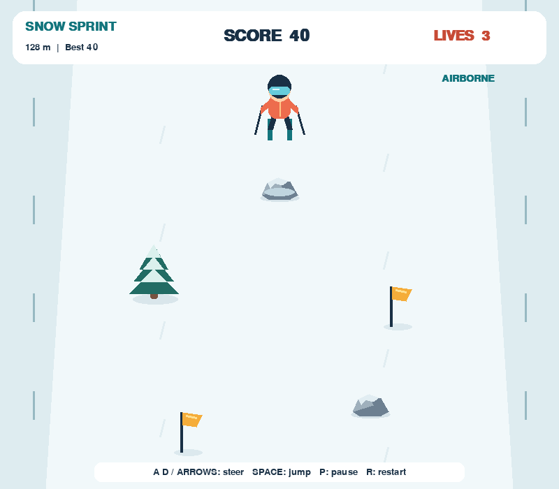

# Fife Python Instruction

Python Club teaching projects prepared by Haodong Yang for the Fife–Penn STEM & CS Academy.
Designed for hands-on exploration with students in grades 5–8.

## Projects

| Project | What students can explore | Source |
| --- | --- | --- |
| Snow Sprint | Keyboard input, variables, randomness, collision rules, and jumping | [Open project](projects/snow_sprint/) |

## Snow Sprint

A small desktop skiing game written in Python and Pygame. Collect golden flags, steer around trees,
and press Space to jump over small rocks. All graphics are drawn in code; no external artwork,
fonts, music, or configuration files are needed.



### Run from source

Use Python 3.11, matching the tested classroom development environment. This project is a desktop
application, not a browser or Chromebook app.

```bash
cd projects/snow_sprint
python -m pip install -r requirements.txt
python ski_game.py
```

If using Conda, create and activate an environment first:

```bash
conda create -n fife python=3.11 -y
conda activate fife
```

On Windows, `launch_game.bat` is an optional launcher after activating the correct Python environment.

### Controls

| Key | Action |
| --- | --- |
| Enter | Start / start again after game over |
| Left / Right or A / D | Hold to steer; release to stop moving sideways |
| Space | Jump; jumping is disabled while falling or already in the air |
| P | Pause / resume |
| R | Restart |
| Esc | Return to menu; press again in the menu to quit |

Flags add 10 points. Trees and rocks cost one life and up to 20 points on collision.
Jump high enough to clear rocks; trees must be avoided even in midair.
You start with three lives, and crashes grant a short recovery period.
The game automatically pauses when its window loses focus. Click the window and press P to resume.
The best score is kept only for the current application session.

### Student experiments

Start with the `STUDENT SETTINGS` section near the top of `ski_game.py`.
Change one value, predict what will happen, then run and test your prediction.

| Setting | Default | Experiment |
| --- | --- | --- |
| `PLAYER_SPEED` | 330 | Compare slower and faster steering |
| `BASE_SPEED` | 230 | Make a beginner-friendly slope |
| `STARTING_LIVES` | 3 | Change the number of attempts |
| `FLAG_POINTS` | 10 | Design a different scoring system |
| `SPAWN_INTERVAL` | 0.85 | Change obstacle spacing |
| `TREE_CHANCE` / `ROCK_CHANCE` | 0.42 / 0.28 | Change obstacle mix; keep the sum at most 1 |
| `JUMP_DURATION` | 1.0 | Change airtime in seconds |
| `JUMP_HEIGHT` | 78 | Change the maximum jump height |
| `PLAYER_COLOR` | (237, 108, 77) | Personalize the skier's clothing |

This is a complete instructor-provided template. Beginners are not expected to write the entire
game from scratch. Follow-up activities can focus on one small feature or rule at a time.

### Package a Windows version for students

Run these commands **on Windows** inside `projects/snow_sprint`, using the working Python environment:

```powershell
python -m pip install pyinstaller
python -m PyInstaller --noconfirm --onedir --windowed --name SnowSprint ski_game.py
```

Alternatively, double-click `build_windows.bat` from a terminal environment where Python and
Pygame are available. It installs PyInstaller in that environment and builds the application.

Zip the **entire** `dist/SnowSprint` folder, including `SnowSprint.exe` and `_internal`.
Windows students extract the ZIP and launch `SnowSprint.exe` without installing Python.
The executable is a playable distribution; students need the source and a Python environment
to edit code. Test the package on a school computer before class.

Build outputs and local Conda environments are not stored in this repository. The Windows package
built on the instructor's laptop is not included here.

## Validation

The jump version was checked using a headless Pygame display for rock collisions on the ground,
rock clearance in the air, tree collisions during a jump, landing, prevention of double jumps,
pause/resume, restart, flag collection, obstacle generation, and rendering of all game screens.
The earlier base game was also exercised in a 60-second simulated scrolling run.
The instructor confirmed that the base game runs and accepts keyboard input on their Windows laptop.
Windows executable packaging must be tested on the destination devices.

## Project notes

The project follows the supplied skier / scrolling-obstacle game idea and was rewritten with
procedural graphics and self-contained game logic. OpenAI Codex assisted with implementation,
documentation, and automated checks. Haodong Yang is responsible for classroom review and adaptation.
This repository is teaching material, not an official school software release.
